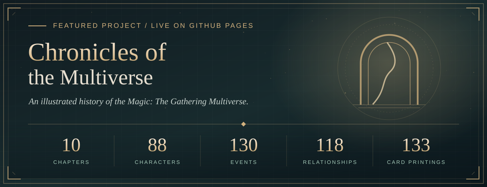

 

**I build thoughtful software — polished web experiences, data-driven tools, and applied machine learning.**

Based in Vancouver, BC. My flagship project is an illustrated, open-source history of the *Magic: The Gathering* Multiverse.

 

[**Chronicles of the Multiverse ↗**](https://devisola.github.io/mtg-history/) &nbsp;·&nbsp; [**LinkedIn**](https://www.linkedin.com/in/dev-disola/) &nbsp;·&nbsp; [**Moxfield**](https://moxfield.com/users/devdisola) &nbsp;·&nbsp; [**Ko-fi**](https://ko-fi.com/devdisola)

 

## Featured project

**[Chronicles of the Multiverse](https://devisola.github.io/mtg-history/)** connects decades of scattered lore — expansions, novels, short fiction and flavour text — into one readable, illustrated chronicle. Ten original chapters run from the ancient Thran to the Omenpaths, with real card printings placed beside the passages they illustrate as *historical artifacts*. It's a reading experience, not a card database.

  

<table>
  <tr>
    <td width="50%" valign="top">
      
       <strong><a href="https://devisola.github.io/mtg-history/relationships/?person=urza">Characters &amp; relationships</a></strong> 
      88 profiles and an explorable graph of 118 documented links — family, alliance, conflict, mentorship — shareable by URL.
    </td>
    <td width="50%" valign="top">
      
       <strong><a href="https://devisola.github.io/mtg-history/timeline/">Timeline atlas</a></strong> 
      Ten eras and 130 events in story order, separating in-world chronology from publication history.
    </td>
  </tr>
  <tr>
    <td width="50%" valign="top">
      
       <strong><a href="https://devisola.github.io/mtg-history/archive/">Illustrated archive</a></strong> 
      Every card reference with its exact printing, artist credit and historical significance.
    </td>
    <td width="50%" valign="top">
      
       <strong><a href="https://devisola.github.io/mtg-history/">Light, dark &amp; mobile</a></strong> 
      Theme follows your system, and the whole archive is designed mobile-first.
    </td>
  </tr>
</table>

**Under the hood**

- **Typed content model** — cards, characters, events, relationships and glossary terms live in typed Astro Content Collections written in MDX.
- **Static by design** — no accounts, database or server; built with Astro and deployed to GitHub Pages through GitHub Actions.
- **Tested like a product** — every deploy runs unit, content-integrity, editorial, type and link checks, plus Playwright regression tests on desktop and mobile Chromium.
- **Reproducible screenshots** — the README tour is captured automatically by Playwright, and a capture fails rather than shipping a broken card image.
- **Accessible interactions** — keyboard-friendly dialogs and inline definitions, and the relationship graph is mirrored by an accessible card list.

`Astro` &nbsp; `TypeScript` &nbsp; `MDX` &nbsp; `SCSS` &nbsp; `Playwright` &nbsp; `GitHub Actions` &nbsp; `GitHub Pages`

  <a href="https://devisola.github.io/mtg-history/"><strong>Enter the archive ↗</strong></a> &nbsp;&nbsp;·&nbsp;&nbsp;
  <a href="https://github.com/DevIsola/mtg-history"><strong>View source ↗</strong></a>

## More work

<table>
  <tr>
    <td width="50%" valign="top">
      
      <h3><a href="https://github.com/DevIsola/CommunityEvents">CommunityEvents</a></h3>
      
A community events web application built with Vue and Vite — an example of my frontend application work.

      
<code>Vue</code> &nbsp; <code>Vite</code> &nbsp; <code>JavaScript</code>

    </td>
    <td width="50%" valign="top">
      
      <h3><a href="https://github.com/DevIsola/ENEB-Project">ENEB Project</a></h3>
      
Notebook-based academic project work in applied data analysis.

      
<code>Jupyter Notebook</code> &nbsp; <code>Data analysis</code>

    </td>
  </tr>
</table>

### On the workbench

<table>
  <tr>
    <td width="50%" valign="top">
      <strong>◈ MTG Event Hub</strong> &nbsp;<code>in development</code>
      
A full-stack platform for community events, vendor workflows and marketplace experiences.

      <code>Next.js</code> &nbsp; <code>TypeScript</code>
    </td>
    <td width="50%" valign="top">
      <strong>◈ Deck Evaluation &amp; ML</strong> &nbsp;<code>research</code>
      
Evaluating Commander decks with structured metrics, simulation and calibration in Python.

      <code>Python</code> &nbsp; <code>Simulation</code> &nbsp; <code>PyTorch</code>
    </td>
  </tr>
</table>

## Toolkit

## How I build

**Make complexity legible.** I like turning tangled information into something people can navigate — strong foundations underneath, a calm and considered interface on top. That means typed data, automated checks, reproducible analysis, and the small design decisions that make software feel finished.

Away from the editor you'll find me at the intersection of strategy games, storytelling, simulation and machine learning — which is usually where my next project starts.

### Let's connect

Open to collaborating, talking shop, or nerding out about Magic lore.

[**LinkedIn**](https://www.linkedin.com/in/dev-disola/) &nbsp;·&nbsp; [**GitHub**](https://github.com/DevIsola?tab=repositories) &nbsp;·&nbsp; [**Moxfield decks**](https://moxfield.com/users/devdisola) &nbsp;·&nbsp; [**Chronicles**](https://devisola.github.io/mtg-history/)

 

If my open-source work is useful to you, you can support it — entirely optional; everything stays free.

  

Built with intention · Documented with care · Always evolving

