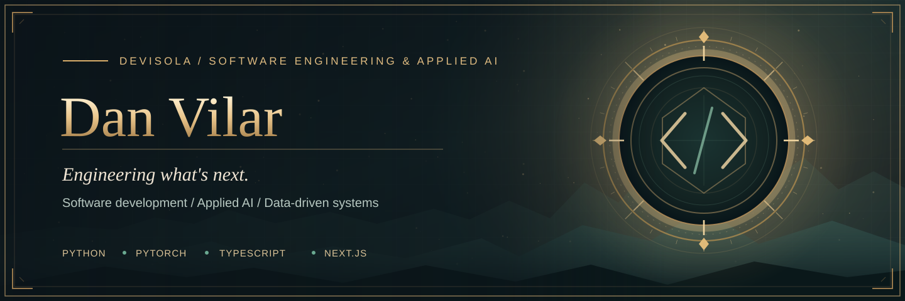
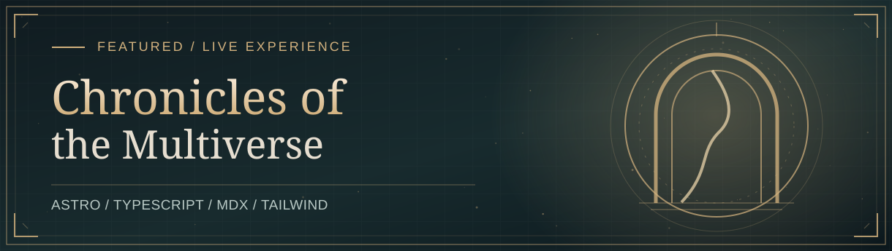
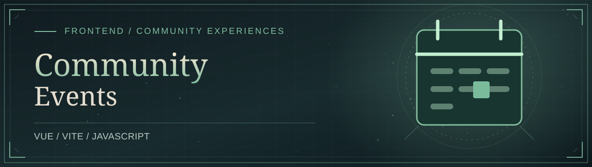
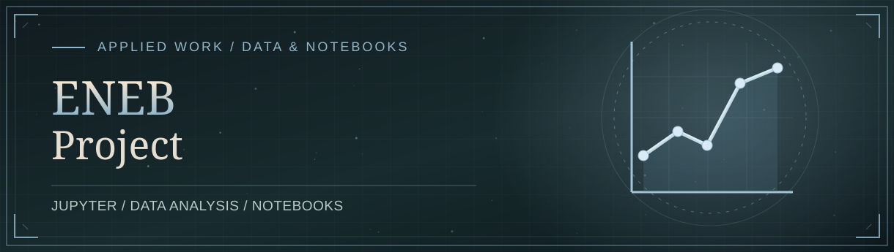
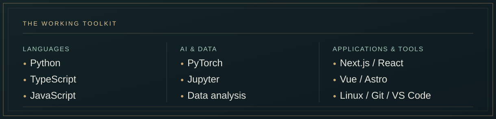

 

**Software developer building thoughtful products, intelligent tools, and data-driven systems.**

I work across full-stack engineering and applied machine learning — from polished web experiences to Python-based analysis and experimentation.

[**Explore my work**](#selected-work) &nbsp;·&nbsp; [**Working stack**](#working-stack) &nbsp;·&nbsp; [**On the workbench**](#on-the-workbench) &nbsp;·&nbsp; [**Get in touch**](#get-in-touch)

 

## My work

**[Chronicles of the Multiverse](https://github.com/DevIsola/mtg-history)** — An illustrated, narrative-first archive of *Magic: The Gathering* history. Its guided timeline, authored chapters, and curated source references turn fragmented lore into an interconnected reading experience.

`Astro` &nbsp; `TypeScript` &nbsp; `MDX` &nbsp; `Tailwind CSS` &nbsp; `GitHub Pages`

[**Visit the live archive ↗**](https://devisola.github.io/mtg-history/) &nbsp;&nbsp; [**View source ↗**](https://github.com/DevIsola/mtg-history)

<table>
  <tr>
    <td width="50%" valign="top">
      
      <h3><a href="https://github.com/DevIsola/CommunityEvents">CommunityEvents</a></h3>
      
A Vue-based community events application project. An example of my frontend application work.

      
<code>Vue</code> &nbsp; <code>Vite</code> &nbsp; <code>JavaScript</code>

      
<a href="https://github.com/DevIsola/CommunityEvents">View repository ↗</a>

    </td>
    <td width="50%" valign="top">
      
      <h3><a href="https://github.com/DevIsola/ENEB-Project">ENEB Project</a></h3>
      
A collection of notebook-based academic project submissions and applied analytical work.

      
<code>Jupyter Notebook</code> &nbsp; <code>Analysis</code>

      
<a href="https://github.com/DevIsola/ENEB-Project">View repository ↗</a>

    </td>
  </tr>
</table>

## Working stack

My everyday environment is **Linux on WSL2**, **VS Code**, **Git**, and **Python**. For applications I work with **TypeScript**, **React / Next.js**, **Vue**, **Astro**, and **Tailwind CSS**. My ML work centers on **PyTorch** and notebook-driven experimentation.

## On the workbench

<table>
  <tr>
    <td width="50%" valign="top">
      <h3>◈ MTG Event Hub</h3>
      
<strong>In development</strong>

      
A full-stack platform for community events, vendor workflows, and marketplace experiences.

      
<code>Next.js</code> &nbsp; <code>TypeScript</code> &nbsp; <code>Product engineering</code>

    </td>
    <td width="50%" valign="top">
      <h3>◈ Deck Evaluation &amp; ML</h3>
      
<strong>Research / development</strong>

      
Exploring Commander deck evaluation with structured metrics, simulation, calibration, and Python-based tooling.

      
<code>Python</code> &nbsp; <code>Simulation</code> &nbsp; <code>PyTorch exploration</code>

    </td>
  </tr>
</table>

## How I approach building

**Make complexity legible.** Good tools connect strong technical foundations with interfaces people want to use. I'm interested in practical intelligence, reproducible analysis, considered architecture, and the small design decisions that make software feel finished.

  
<strong>A little more about my interests</strong>

   
  Beyond application engineering, I enjoy the intersection of interactive storytelling, strategy games, simulation, and machine learning. Those interests often become the projects I use to explore new engineering ideas.

## Get in touch

Interested in collaborating, discussing a project, or exploring something technical?

[**GitHub**](https://github.com/DevIsola) &nbsp;·&nbsp; [**Repositories**](https://github.com/DevIsola?tab=repositories) &nbsp;·&nbsp; [**Chronicles of the Multiverse**](https://devisola.github.io/mtg-history/)

   
  Built with intention. Documented with care. Always evolving.

